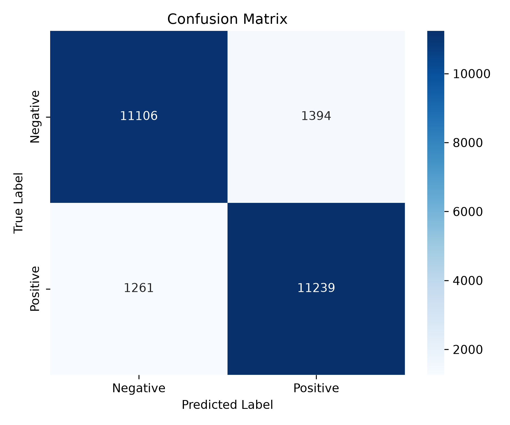

# Sentiment Analysis on Movie Reviews

An explainable, end-to-end Machine Learning pipeline for binary sentiment classification (Positive / Negative) on the official **50,000 IMDB Movie Reviews** dataset.

---

## Key Highlights

- **Model:** TF-IDF Vectorizer (10,000 features, Unigrams + Bigrams) + Logistic Regression ($C=1.0$).
- **Principled Negation Handling:** Does **not** strip English stop words. This ensures sentiment-critical negations (`not`, `no`, `never`) are retained and captured in bigrams like `"not good"`.
- **Explainability:** Real-time feature attribution via element-wise coefficient weighting ($w_i \cdot x_i$), showing which specific words push predictions toward Positive or Negative.
- **Empirical Results (Test Split):**
  - **Accuracy:** **89.34%** (vs. 50.00% Majority-Class Baseline)
  - **Precision:** **88.96%**
  - **Recall:** **89.83%**
  - **F1-Score:** **89.40%**
- **Error Analysis:** Real-world misclassified examples exported and analyzed for presentation.

---

## Project Structure

```text
.
├── requirements.txt           # Project dependencies
├── README.md                  # Project documentation
├── .gitignore                 # Excludes models, results, and pycache
├── app.py                     # Streamlit demo application
├── src/
│   ├── preprocess.py          # clean_text() function
│   └── train.py               # Data loading, training, evaluation, artifact export
├── models/
│   └── tfidf_logreg.joblib    # Serialized scikit-learn pipeline (model checkpoint)
├── results/
│   ├── metrics.json           # Evaluation metrics + baseline
│   ├── confusion_matrix.png   # Confusion matrix heatmap
│   ├── misclassified.json     # Real misclassified test reviews for error analysis
│   └── classification_report.txt
└── slides/
    └── outline.md             # 7-slide presentation script & viva cheat sheet
```

---

## Quickstart

### 1. Install Dependencies
```bash
pip install -r requirements.txt
```

### 2. Run Preprocessing Unit Check
```bash
python src/preprocess.py
```

### 3. Train & Evaluate the Model

**Smoke Test (Fast 1,000 samples):**
```bash
python src/train.py --samples 1000
```

**Full Training (Official 25k train / 25k test splits):**
```bash
python src/train.py
```
This generates:
- `models/tfidf_logreg.joblib`
- `results/metrics.json`
- `results/confusion_matrix.png`
- `results/misclassified.json`
- `results/classification_report.txt`

### 4. Launch the Interactive Demo
```bash
streamlit run app.py
```
Open [https://imdb-movies-sentiment-analysis.streamlit.app/](https://imdb-movies-sentiment-analysis.streamlit.app/) in your browser.

---

## Evaluation Summary

Evaluated on the official held-out test split of 25,000 reviews:

| Metric | TF-IDF + Logistic Regression | Majority-Class Baseline |
| :--- | :---: | :---: |
| **Accuracy** | **89.34%** | 50.00% |
| **Precision** | **88.96%** | 50.00% |
| **Recall** | **89.83%** | 100.00% |
| **F1-Score** | **89.40%** | 66.67% |

### Confusion Matrix Heatmap



---


